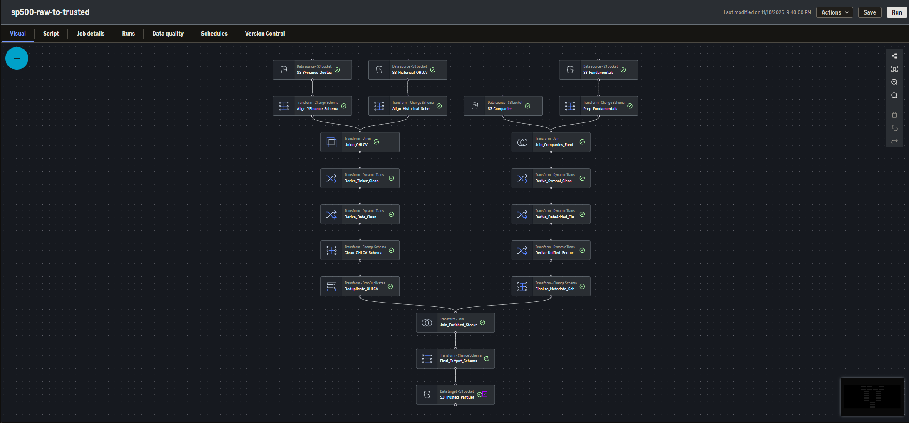
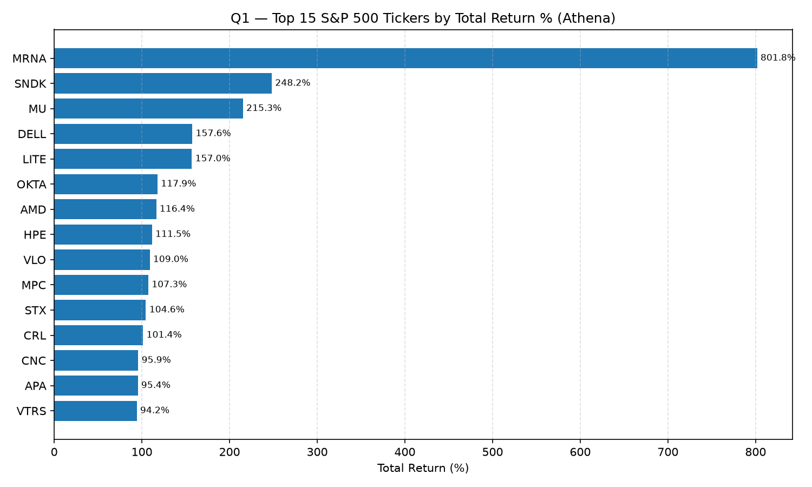
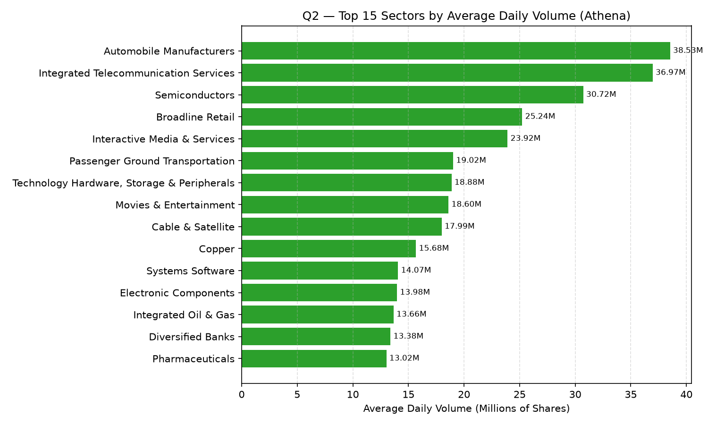
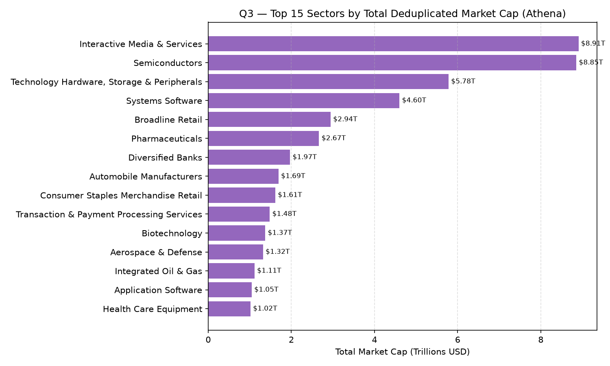
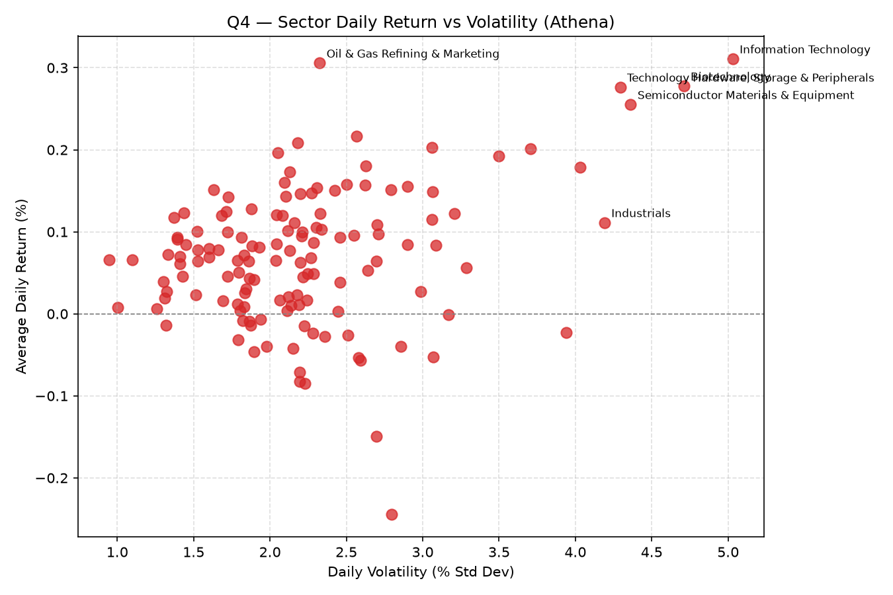
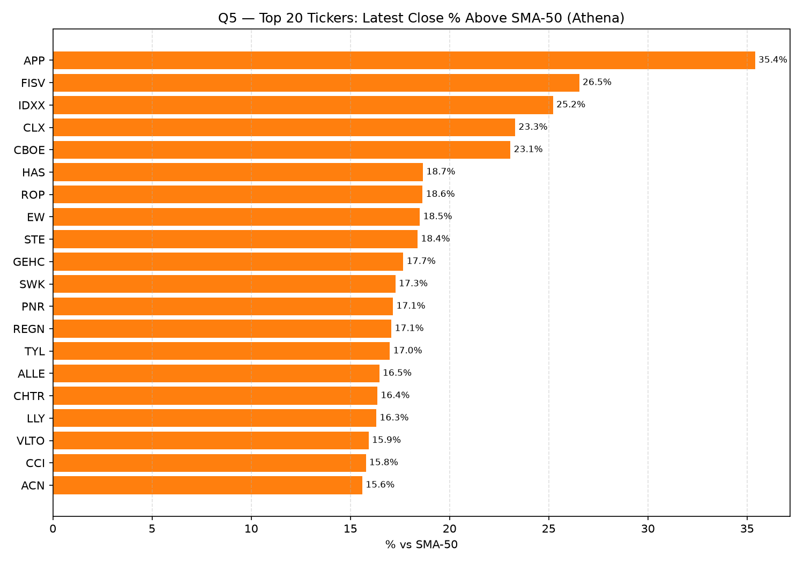

# ST0263 Big Data Project 2 — S&P 500 Equities Lakehouse on AWS

Universidad EAFIT — **ST0263 Tópicos Especiales en Telemática (2026-1)** ([project spec](ST0263-261-proyecto2.pdf)).

End-to-end AWS Data Lakehouse (`us-east-1`, S3 bucket `stock-big-data-bucket`, Glue Data Catalog `stocks_db.stocks_enriched`) ingesting S&P 500 company fundamentals (RDS MariaDB), historical OHLCV CSVs (EC2), and daily Yahoo Finance JSON bars into Medallion S3 zones (`raw/` → `trusted/` → `refined/`).

- **Architecture Diagram:** [Lucidchart — ST0263 Big Data AWS Architecture](https://lucid.app/lucidchart/cfae0167-5d6b-4944-b8d5-1c3cd50f1aa1/edit?page=EwUbr1p0YOTyF)
- **Public API Gateway (`prod`):** `https://ldufp8c5w2.execute-api.us-east-1.amazonaws.com/prod`
- **Streamlit Dashboard (`:8501`):** `http://54.224.176.52:8501` (FastAPI Swagger: `http://54.224.176.52:8000/docs`)

---

## I. Integrantes del proyecto

- David Curelop 
- Moises Vergara

- **Repositorio GitHub:** `https://github.com/DavidCurelop/BigDataProyect`

---

## II. Requerimientos — Caso de Estudio y Preguntas de Negocio (Q1–Q5)

Caso de estudio sobre acciones del índice **S&P 500**, combinando datos maestros/fundamentales en **Amazon RDS MariaDB**, históricos diarios OHLCV en archivos CSV en **EC2**, y cotizaciones diarias vía URL (**Yahoo Finance v8 API**):

1. **Q1 — Top Tickers by Total Return %:** Which S&P 500 tickers delivered the highest cumulative return over the observed period (overall and within each sector)?
2. **Q2 — Average Trading Volume & Volume Leaders by Sector:** Which sectors record the highest average/total daily trading volume, and which stocks lead trading volume within each sector?
3. **Q3 — Sector Market-Cap Ranking:** How do sectors rank by total deduplicated market capitalization and average company market cap?
4. **Q4 — Daily Return % & Volatility by Sector:** What are the daily percentage returns per stock, and which sectors exhibit the highest average daily return and daily volatility?
5. **Q5 — 50-Day Simple Moving Average (`SMA-50`):** How does each ticker's daily closing price compare against its rolling 50-day Simple Moving Average (`SMA-50` and `% vs SMA-50`)?

## Repository Structure

| Directory | Scope | Key Files |
|---|---|---|
| [`punto1/`](punto1/) | **Punto 1:** Case study, schemas, Q1–Q5 & AWS/IAM architecture | [`README.md`](punto1/README.md) |
| [`punto2/`](punto2/) | **Punto 2:** RDS MariaDB (`sp500`), EC2 OHLCV CSVs & Internet URLs | [`README.md`](punto2/README.md), [`schema.sql`](punto2/schema.sql), [`load_and_verify.py`](punto2/load_and_verify.py), [`stage_and_verify_ohlcv.py`](punto2/stage_and_verify_ohlcv.py), [`verify.sql`](punto2/verify.sql) |
| [`punto3/`](punto3/) | **Punto 3:** Automated multi-source S3 raw ingestion (`crond`) | [`README.md`](punto3/README.md), [`s3_ingestion.py`](punto3/s3_ingestion.py), [`test_s3_ingestion.py`](punto3/test_s3_ingestion.py) |
| [`punto4/`](punto4/) | **Punto 4:** Raw-to-Trusted AWS Glue 4.0 PySpark ETL job | [`README.md`](punto4/README.md), [`sp500_raw_to_trusted.py`](punto4/sp500_raw_to_trusted.py), [`Evidencia/AWSGlue.png`](punto4/Evidencia/AWSGlue.png) |
| [`punto5/`](punto5/) | **Punto 5:** Glue Data Catalog (`sp500-trusted-crawler`) & EMR Hive/SparkSQL checks | [`README.md`](punto5/README.md), [`verify_hive.q`](punto5/verify_hive.q), [`verify_sparksql.py`](punto5/verify_sparksql.py) |
| [`punto6/`](punto6/) | **Punto 6:** Descriptive SQL (Q1–Q5) for Athena, EMR Hive/Hue & SparkSQL | [`README.md`](punto6/README.md), `athena/q*.sql`, `emr/q*.sql`, [`emr/run_all_emr.sql`](punto6/emr/run_all_emr.sql) |
| [`punto7/`](punto7/) | **Punto 7:** Programmatic PySpark pipeline ([Colab notebook](https://colab.research.google.com/drive/1CBB_D0g9144pPL8zfwOVABmRLJKc6h9u)) → `refined/analytics_results/` | [`README.md`](punto7/README.md), [`punto7_analytics_colab.ipynb`](punto7/punto7_analytics_colab.ipynb) |
| [`punto8/`](punto8/) | **Punto 8:** FastAPI (`:8000`), API Gateway (`prod`), Streamlit (`:8501`) & Matplotlib charts | [`README.md`](punto8/README.md), [`api.py`](punto8/api.py), [`dashboard.py`](punto8/dashboard.py), [`athena_matplotlib_charts.ipynb`](punto8/athena_matplotlib_charts.ipynb), [`test_punto8.py`](punto8/test_punto8.py) |

## Quick Setup

```powershell
Copy-Item .env.example .env
python -m venv .venv
.\.venv\Scripts\pip install -r requirements.txt
```

---

## III. Desarrollo

### Punto 1 — Caso de Estudio, Preguntas de Negocio y Arquitectura AWS
- **Descripción:** Definición de las 5 preguntas analíticas (Q1–Q5), esquemas de origen (`sp500.companies`, `sp500.fundamentals`, OHLCV CSV, Yahoo Finance NDJSON), bucket S3 `stock-big-data-bucket` (`raw/`, `trusted/`, `refined/`, `athena-results/`), IAM `LabRole`/`LabInstanceProfile` y Security Group `sp500-ec2-sg`.
- **Instrucciones y detalle:** [`punto1/README.md`](punto1/README.md).

### Punto 2 — Fuentes de Datos (RDS MariaDB, Archivos en EC2 y URLs en Internet)
- **Descripción:** Creación y carga de `sp500.companies` y `sp500.fundamentals` en Amazon RDS MariaDB desde datasets públicos en GitHub, y generación/verificación de archivos CSV históricos OHLCV (`/data/ohlcv/*.csv`) en EC2 usando la API pública de Yahoo Finance.
- **Reproducción:**
  ```bash
  python punto2/load_and_verify.py
  python3 punto2/stage_and_verify_ohlcv.py
  ```
- **Instrucciones y scripts:** [`punto2/README.md`](punto2/README.md).

### Punto 3 — Ingesta Automática hacia Datalake S3 (`raw/`)
- **Descripción:** Script [`punto3/s3_ingestion.py`](punto3/s3_ingestion.py) programado con `crond` en EC2 (`0 23 * * 1-5` con `flock`) que exporta RDS a `raw/rds_companies/{companies,fundamentals}/`, sincroniza `/data/ohlcv/` a `raw/ec2_historical_ohlcv/`, y escribe cotizaciones diarias NDJSON en `raw/yfinance_quotes/dt=YYYY-MM-DD/quotes.json`.
- **Reproducción y tests:**
  ```powershell
  .\.venv\Scripts\python -m unittest -v punto3\test_s3_ingestion.py
  ```
- **Instrucciones:** [`punto3/README.md`](punto3/README.md).

### Punto 4 — Preparación de Datos Raw → Trusted (AWS Glue & Apache Spark)
- **Descripción:** Job visual de AWS Glue 4.0 ([`punto4/sp500_raw_to_trusted.py`](punto4/sp500_raw_to_trusted.py), `sp500-raw-to-trusted`) que une OHLCV histórico con Yahoo Finance, normaliza `ticker` y `date`, elimina duplicados `(ticker, date)`, realiza `left join` con `companies` y `fundamentals`, valida calidad (`ColumnCount > 0`) y escribe Parquet Snappy particionado por `sector` en `s3://stock-big-data-bucket/trusted/stocks_enriched/`.
- **Evidencia (AWS Glue Visual ETL DAG):**



- **Instrucciones:** [`punto4/README.md`](punto4/README.md).

### Punto 5 — Catalogación SQL (AWS Glue Data Catalog & EMR Hive/SparkSQL)
- **Descripción:** AWS Glue Crawler `sp500-trusted-crawler` cataloga `s3://stock-big-data-bucket/trusted/stocks_enriched/` en la tabla `stocks_db.stocks_enriched`, verificada en EMR mediante [`punto5/verify_hive.q`](punto5/verify_hive.q) y [`punto5/verify_sparksql.py`](punto5/verify_sparksql.py).
- **Reproducción en EMR:**
  ```bash
  hive -f ~/punto5/verify_hive.q
  spark-submit --conf spark.hadoop.hive.metastore.client.factory.class=com.amazonaws.glue.catalog.metastore.AWSGlueDataCatalogHiveClientFactory ~/punto5/verify_sparksql.py
  ```
- **Instrucciones:** [`punto5/README.md`](punto5/README.md).

### Punto 6 — Consultas Analíticas Descriptivas con SQL (Athena, EMR Hive/Hue y SparkSQL)
- **Descripción:** Consultas SQL para Q1–Q5 sobre `stocks_db.stocks_enriched` adaptadas para Amazon Athena ([`punto6/athena/`](punto6/athena/)) y EMR Hive/Hue/SparkSQL ([`punto6/emr/`](punto6/emr/)).
- **Reproducción en EMR:**
  ```bash
  hive -f ~/punto6/emr/run_all_emr.sql | tee ~/hive_punto6.log
  spark-sql --conf spark.hadoop.hive.metastore.client.factory.class=com.amazonaws.glue.catalog.metastore.AWSGlueDataCatalogHiveClientFactory -f ~/punto6/emr/run_all_emr.sql | tee ~/sparksql_punto6.log
  ```
- **Instrucciones:** [`punto6/README.md`](punto6/README.md).

### Punto 7 — Consultas y Procesamiento Analítico con PySpark
- **Descripción:** Pipeline programático en PySpark ([`punto7/punto7_analytics_colab.ipynb`](punto7/punto7_analytics_colab.ipynb) / [Google Colab](https://colab.research.google.com/drive/1CBB_D0g9144pPL8zfwOVABmRLJKc6h9u)) usando DataFrame API (`groupBy`, `Window`, `avg`, `max`, `rank`) para calcular y exportar a `s3://stock-big-data-bucket/refined/analytics_results/` las tablas Parquet `daily_returns_sma50/`, `sector_summary/`, `top_gainers/` y `volume_leaders_by_sector/`.
- **Instrucciones:** [`punto7/README.md`](punto7/README.md).

### Punto 8 — Visualización (Matplotlib + Streamlit) y Exposición vía API Gateway
- **Descripción:**
  - **Gráficas estáticas Matplotlib sobre Athena:** Notebook [`punto8/athena_matplotlib_charts.ipynb`](punto8/athena_matplotlib_charts.ipynb) ejecutando `punto6/athena/q1..q5` y generando `chart_q1..q5_*.png`.
  - **API REST & API Gateway:** Servicio FastAPI ([`punto8/api.py`](punto8/api.py), puerto `8000`) leyendo Parquet de `refined/analytics_results/` en S3 y expuesto vía Amazon API Gateway (`prod`: `https://ldufp8c5w2.execute-api.us-east-1.amazonaws.com/prod`).
  - **Dashboard Streamlit:** Aplicación interactiva ([`punto8/dashboard.py`](punto8/dashboard.py), puerto `8501`) conectada al endpoint de API Gateway.
- **Reproducción y tests:**
  ```powershell
  .\.venv\Scripts\python -m unittest -v punto8\test_punto8.py
  ```
- **Evidencias Matplotlib (Q1–Q5):**

| Q1 — Top Gainers | Q2 — Sector Volume | Q3 — Sector Market Cap |
|---|---|---|
|  |  |  |

| Q4 — Risk vs Return | Q5 — SMA-50 |
|---|---|
|  |  |

- **Instrucciones:** [`punto8/README.md`](punto8/README.md).
