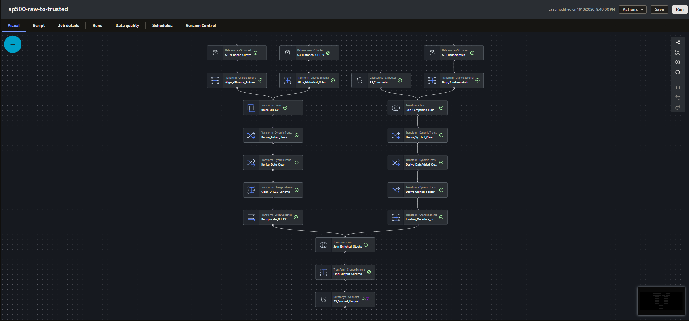

# Punto 4 – Raw-to-Trusted AWS Glue PySpark ETL (US 3.1)

AWS Glue 4.0 visual ETL job (`sp500-raw-to-trusted`, IAM `LabRole`) that normalizes, joins, and deduplicates all three raw S3 sources into Snappy Parquet under `s3://stock-big-data-bucket/trusted/stocks_enriched/` partitioned by `sector`.



## Script
- [`sp500_raw_to_trusted.py`](sp500_raw_to_trusted.py) — Exported from `s3://aws-glue-assets-294181470677-us-east-1/scripts/sp500-raw-to-trusted.py`.

## Transformations Applied
1. Reads `raw/rds_companies/companies/`, `raw/rds_companies/fundamentals/`, `raw/ec2_historical_ohlcv/` (CSV), and `raw/yfinance_quotes/` (NDJSON).
2. Unions historical OHLCV and daily Yahoo Finance quotes, normalizes `ticker` (`trim`/`upper`) and ISO `date` (`YYYY-MM-DD`), and drops duplicate `(ticker, date)` rows.
3. Left-joins `companies` and `fundamentals` (coalescing `sector` from `fundamentals.sector` / `companies.gics_sector`).
4. Runs Glue Data Quality (`ColumnCount > 0`) and writes Snappy Parquet partitioned by `sector` to `s3://stock-big-data-bucket/trusted/stocks_enriched/`.

## How to Reproduce (AWS Glue Studio / CLI)
1. Upload `sp500_raw_to_trusted.py` to your Glue scripts bucket (or paste into **AWS Glue → ETL jobs → Visual / Script editor**).
2. Create Glue 4.0 job `sp500-raw-to-trusted` using IAM role `LabRole`, Python 3, and Worker type `G.1X` (2+ workers).
3. Run the job via AWS Glue Console or CLI:
   ```bash
   aws glue start-job-run --job-name sp500-raw-to-trusted
   aws s3 ls s3://stock-big-data-bucket/trusted/stocks_enriched/
   ```
