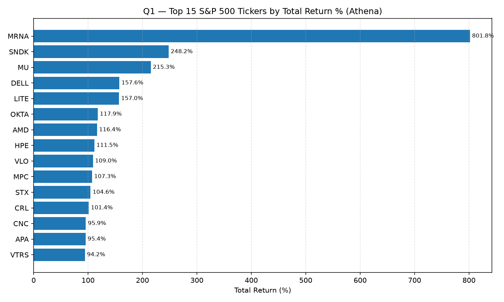
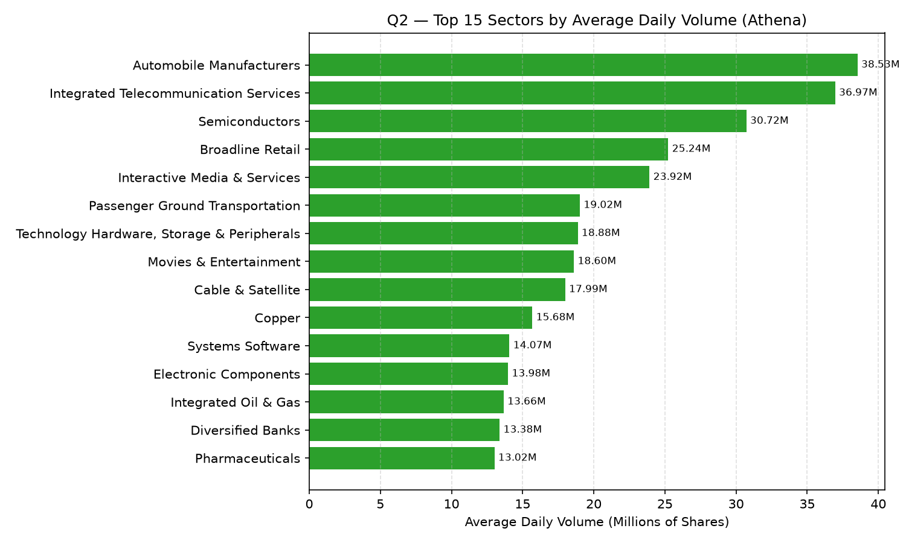
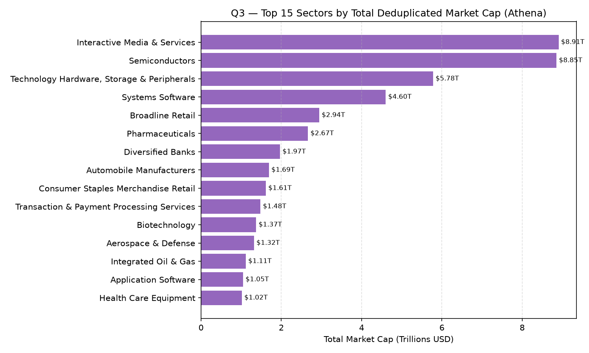
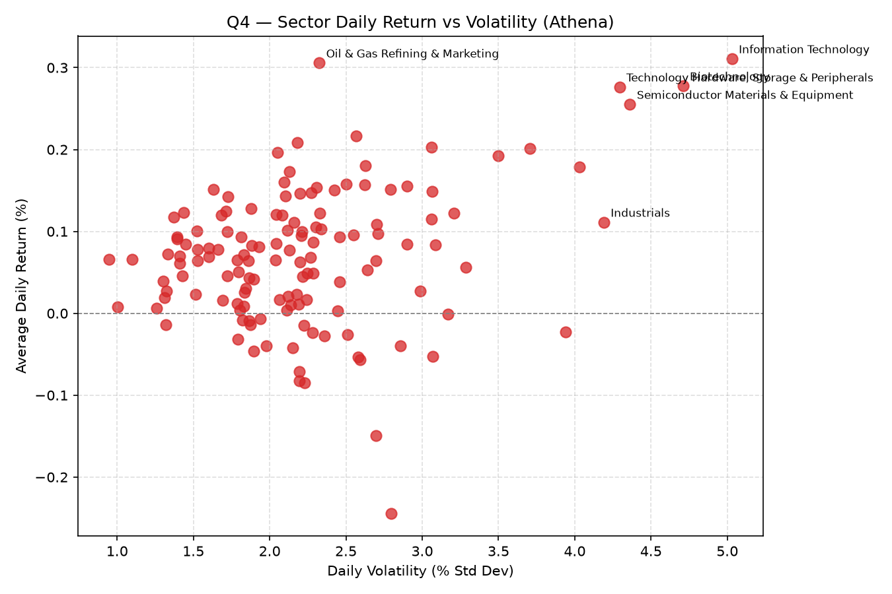
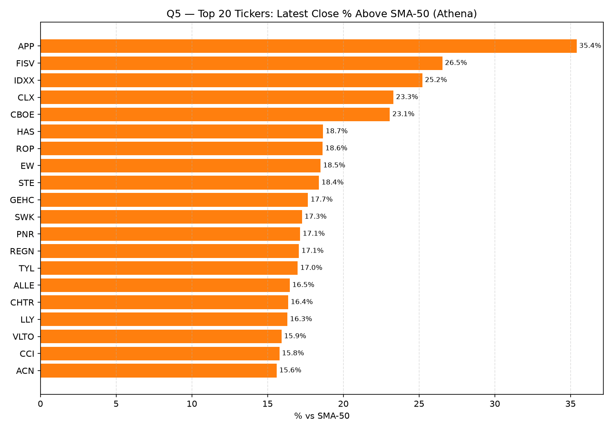

# Punto 8 – FastAPI, API Gateway, Streamlit & Matplotlib Visuals (US 5.1 & 5.2)

- **Public API Gateway (`prod`):** `https://ldufp8c5w2.execute-api.us-east-1.amazonaws.com/prod`
- **Streamlit Dashboard (`:8501`):** `http://54.224.176.52:8501`
- **FastAPI Docs (`:8000`):** `http://54.224.176.52:8000/docs`

## Files
- `api.py`: FastAPI (`:8000`) reading `s3://stock-big-data-bucket/refined/analytics_results/` Parquet via `boto3`.
- `dashboard.py`: Streamlit (`:8501`) consuming `API_BASE_URL` (local `:8000` or Amazon API Gateway `prod` HTTPS URL).
- `athena_matplotlib_charts.ipynb`: Executes `punto6/athena/q1..q5` via `boto3` Athena and exports `chart_q1..q5_*.png`.
- `test_punto8.py`: Unit tests for API serialization (`NaN` -> `null`, dates) and Streamlit `fetch_api`.

## Static Matplotlib Charts (Athena SQL)
- **Q1 — Top 15 Tickers by Return %:** 
- **Q2 — Top 15 Sectors by Avg Daily Volume:** 
- **Q3 — Top 15 Sectors by Market Cap:** 
- **Q4 — Sector Daily Return vs Volatility:** 
- **Q5 — Top 20 Tickers % vs SMA-50:** 

## Run Locally
```powershell
.\.venv\Scripts\pip install -r punto8\requirements.txt
$env:AWS_SHARED_CREDENTIALS_FILE = (Resolve-Path .\.aws\credentials).Path
.\.venv\Scripts\python -m unittest -v punto8\test_punto8.py

# Terminal 1
.\.venv\Scripts\uvicorn punto8.api:app --host 0.0.0.0 --port 8000
# Terminal 2
.\.venv\Scripts\streamlit run punto8\dashboard.py --server.port 8501
```

## Deploy on EC2 (`LabInstanceProfile`, no hardcoded AWS keys)
```bash
scp -i .aws/sp500-ec2-key.pem -r punto8 ec2-user@54.224.176.52:/home/ec2-user/
ssh -i .aws/sp500-ec2-key.pem ec2-user@54.224.176.52
cd /home/ec2-user/punto8 && python3 -m venv .venv && .venv/bin/pip install -r requirements.txt

nohup .venv/bin/uvicorn api:app --host 0.0.0.0 --port 8000 --workers 1 > ~/fastapi.log 2>&1 &
API_BASE_URL="https://ldufp8c5w2.execute-api.us-east-1.amazonaws.com/prod" \
  nohup .venv/bin/streamlit run dashboard.py --server.address 0.0.0.0 --server.port 8501 --server.headless true > ~/streamlit.log 2>&1 &
```
